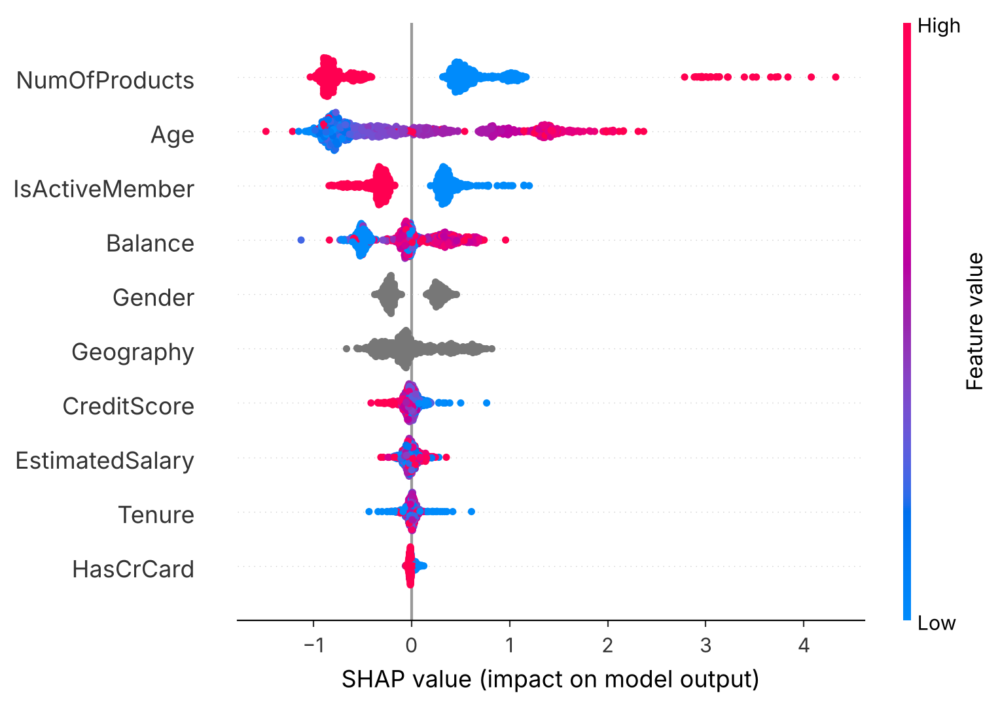

# Прогнозирование оттока клиентов банка

Модель, которая по данным о клиенте предсказывает, уйдёт ли он из банка, и объясняет, какие факторы на это влияют. Проект проходит путь от разведочного анализа до интерпретации модели и рекомендаций для бизнеса.

| | |
|---|---|
| **Задача** | бинарная классификация с дисбалансом классов (уходит около 20% клиентов) |
| **Целевая метрика** | F1 на тестовой выборке не ниже `0.59`; дополнительно ROC-AUC |
| **Результат на тесте** | F1 `0.629`, ROC-AUC `0.859` |
| **Финальная модель** | CatBoost с встроенным взвешиванием классов |
| **Стек** | Python, pandas, scikit-learn, imbalanced-learn, CatBoost, SHAP |

Весь код, графики и выводы находятся в ноутбуке [`bank_churn_prediction.ipynb`](bank_churn_prediction.ipynb).

## Содержание

- [Бизнес-задача](#бизнес-задача)
- [Что сделано](#что-сделано)
- [Данные](#данные)
- [Структура репозитория](#структура-репозитория)
- [Ход решения](#ход-решения)
- [Результаты](#результаты)
- [Что влияет на отток](#что-влияет-на-отток)
- [Рекомендации для бизнеса](#рекомендации-для-бизнеса)
- [Возможные улучшения](#возможные-улучшения)
- [Запуск](#запуск)

## Бизнес-задача

Из банка каждый месяц уходят клиенты. Удержать действующего клиента дешевле, чем привлечь нового, поэтому банку нужно заранее знать, кто собирается уйти, чтобы вовремя предложить бонусы или персональные условия.

Критерий успеха: F1 на отложенной тестовой выборке не ниже `0.59`.

## Что сделано

- Проведён разведочный анализ: типы, пропуски, дубликаты, распределения, баланс классов.
- Реализованы два подхода к дисбалансу классов: синтетическое дополнение выборки (SMOTE) и взвешивание классов в CatBoost.
- Обучены три модели: логистическая регрессия, случайный лес и CatBoost, для каждой подобраны гиперпараметры.
- Все модели сравниваются на одних и тех же обучающей, валидационной и тестовой выборках.
- Кодировщик, масштабирование и SMOTE обучаются только на обучающей выборке, поэтому утечки в валидацию и тест нет.
- Итоговое качество измерено на отложенной тестовой выборке и сопоставлено с константным предсказанием.
- Модель интерпретирована через SHAP, по результатам сформулированы рекомендации для бизнеса.

## Данные

Публичный датасет Churn Modelling с Kaggle: 10 000 клиентов, 14 столбцов, пропусков и дубликатов нет. Файл `Churn_Modelling.csv` лежит в репозитории.

| Признак | Описание |
|---|---|
| `CreditScore` | кредитный рейтинг |
| `Geography` | страна проживания (Франция, Германия, Испания) |
| `Gender` | пол |
| `Age` | возраст |
| `Tenure` | сколько лет человек является клиентом банка |
| `Balance` | баланс на счёте |
| `NumOfProducts` | число продуктов банка, которыми пользуется клиент |
| `HasCrCard` | наличие кредитной карты |
| `IsActiveMember` | активность клиента |
| `EstimatedSalary` | предполагаемая зарплата |
| **`Exited`** | **целевой признак: 1, если клиент ушёл** |

Столбцы `RowNumber`, `CustomerId` и `Surname` являются идентификаторами и в обучении не участвуют.

## Структура репозитория

```text
.
├── README.md                      # описание проекта
├── bank_churn_prediction.ipynb    # решение: EDA, модели, сравнение, SHAP
├── Churn_Modelling.csv            # данные
├── requirements.txt               # зависимости
└── images
    └── shap_summary.png           # график важности признаков
```

## Ход решения

### 1. Разведочный анализ

- Классы несбалансированы: осталось 79,6% клиентов, ушло 20,4%. Поэтому метрикой выбрана F1, а не Accuracy, и при обучении используется балансировка.
- `CreditScore` и `Age` распределены близко к нормальному, пик возраста около 40 лет.
- У `Balance` много нулевых значений: часть клиентов пользуется услугами банка без накоплений.
- Числовые признаки имеют разный масштаб (возраст в десятках, зарплата в сотнях тысяч), для линейной модели нужно масштабирование.

### 2. Подготовка данных

Данные разделены на обучающую, валидационную и тестовую выборки в пропорции 80/10/10 со стратификацией по целевому признаку. Гиперпараметры подбираются на валидации, тестовая выборка используется только для итоговой проверки.

### 3. Классические модели

- категориальные признаки закодированы через `OneHotEncoder`;
- числовые признаки приведены к одному масштабу через `StandardScaler`;
- обучающая выборка сбалансирована методом SMOTE;
- для логистической регрессии перебирался параметр регуляризации `C` (от 0.01 до 0.99);
- для случайного леса перебирались число деревьев (1–39) и глубина (5–19), лучший вариант: 35 деревьев глубины 12.

### 4. CatBoost

Модель получает те же выборки, но в исходном виде: без One-Hot кодирования, масштабирования и SMOTE.

- дисбаланс учитывается параметром `auto_class_weights='Balanced'`;
- до 1000 итераций с ранней остановкой по ROC-AUC на валидации (50 итераций без улучшения);
- перебор по сетке: `depth` ∈ {4, 6, 8}, `learning_rate` ∈ {0.03, 0.05, 0.1};
- лучшая конфигурация: `depth=6`, `learning_rate=0.1`.

## Результаты

| Модель | F1 (валидация) | ROC-AUC (валидация) | F1 (тест) | ROC-AUC (тест) |
|---|---:|---:|---:|---:|
| Логистическая регрессия (SMOTE) | 0.509 | 0.776 | 0.497 | 0.772 |
| Случайный лес (SMOTE) | 0.645 | 0.864 | 0.626 | 0.846 |
| **CatBoost** | 0.623 | **0.886** | **0.629** | **0.859** |

**Почему CatBoost.** На валидации случайный лес показал более высокий F1, а CatBoost более высокий ROC-AUC. Финальной моделью выбран CatBoost по двум причинам:

1. ROC-AUC показывает, насколько хорошо модель упорядочивает клиентов по вероятности ухода. Для удержания это ключевое свойство: бюджет кампании ограничен, и предложения получают клиенты с наибольшим риском.
2. F1 случайного леса получен как лучший из 585 комбинаций параметров на валидационной выборке из 1000 клиентов. При таком широком переборе оценка частично подстраивается под валидацию. У CatBoost перебиралось 9 комбинаций.

Тестовая выборка это подтвердила: F1 случайного леса снизился с 0.645 до 0.626, а результат CatBoost остался стабильным (0.623 на валидации, 0.629 на тесте). По ROC-AUC CatBoost лучше и на валидации, и на тесте.

**Итог.** F1 на тесте равен `0.629` при целевом пороге `0.59`. Константная модель, которая всем клиентам предсказывает уход, даёт F1 `0.337`.

## Что влияет на отток



Признаки на графике упорядочены по силе влияния на прогноз. Точки справа от нуля повышают вероятность ухода, слева понижают; цвет показывает значение признака.

1. **Число продуктов.** Самый сильный признак. Надёжнее всего клиенты с двумя продуктами, клиенты с одним уходят чаще, а клиенты с тремя и четырьмя находятся в зоне максимального риска.
2. **Возраст.** Чем старше клиент, тем выше вероятность ухода; молодые клиенты лояльнее.
3. **Активность.** Неактивные клиенты уходят заметно чаще активных.
4. **Баланс.** Влияние слабее и менее однозначное, но высокий баланс чаще связан с повышенным риском.

Кредитный рейтинг, зарплата, срок обслуживания и наличие кредитной карты на прогноз почти не влияют.

## Рекомендации для бизнеса

- **Клиенты 40–50 лет и старше.** Предложить специальные накопительные или пенсионные программы.
- **Неактивные клиенты.** Запустить кампании по вовлечению: персональные уведомления, бонусы за использование продуктов.
- **Клиенты с тремя и более продуктами.** Разобраться, почему они уходят: возможно, условия пакетов услуг становятся невыгодными по мере накопления продуктов.

## Возможные улучшения

- Подобрать порог классификации под F1 или под стоимость удержания клиента вместо стандартного 0.5.
- Оценивать модели на кросс-валидации, чтобы получить более устойчивые метрики.
- Добавить новые признаки, например признак нулевого баланса или отношение баланса к зарплате.

## Запуск

```bash
pip install -r requirements.txt
jupyter notebook bank_churn_prediction.ipynb
```

Ноутбук читает `Churn_Modelling.csv` из той же папки. Версии библиотек в `requirements.txt` соответствуют запуску, результаты которого сохранены в ноутбуке (Python 3.13). Ноутбук также можно открыть в Google Colab, загрузив файл с данными в сессию.
