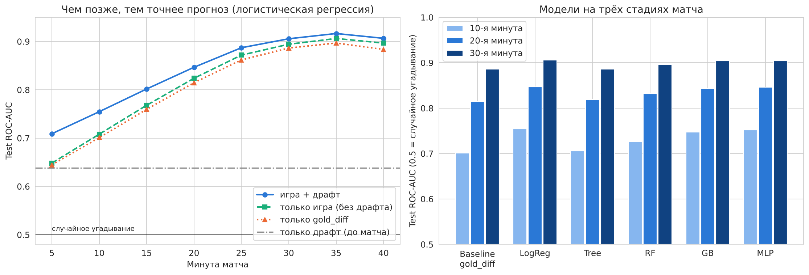

# Предсказание победителя матча Dota 2 на разных стадиях игры

ML-проект по теме «Предсказание победителя киберспортивного матча»: по выбранным героям и состоянию игры на 10-й, 20-й и 30-й минуте предсказываем, победит ли команда Radiant, и разбираемся, какие признаки важны на разных стадиях матча.

## Результаты

Test ROC-AUC на отложенных 20% матчей:

| Модель | 10-я минута | 20-я минута | 30-я минута |
|---|---|---|---|
| Baseline: только перевес по золоту | 0.7009 | 0.8146 | 0.8864 |
| Decision Tree | 0.7056 | 0.8188 | 0.8859 |
| Random Forest | 0.7270 | 0.8320 | 0.8963 |
| Gradient Boosting | 0.7477 | 0.8431 | 0.9042 |
| MLP (PyTorch) | 0.7518 | 0.8460 | 0.9042 |
| **Logistic Regression** | **0.7547** | **0.8466** | **0.9056** |

На 20-й минуте stacking даёт 0.8470, blending — 0.8457: в пределах разброса по фолдам (около 0.006) они неотличимы от логистической регрессии.

Главные выводы:

- Чем позже стадия, тем точнее прогноз. До начала матча один драфт даёт ROC-AUC 0.638. Часть роста объясняется отбором: к 30-й минуте в выборке остаются только матчи, которые ещё идут.
- Перевес по золоту и опыту — главный сигнал на всех стадиях. Драфт важен в начале и теряет вес. Убийства в командных драках и объекты (башни, бараки, Рошан) сами по себе информативны, но почти не добавляют нового к экономике: за них команда получает золото и опыт. Полного KDA по минутам в датасете нет.
- Логистическая регрессия не уступает MLP и ансамблям на всех трёх стадиях: нелинейные модели не нашли ничего сверх линейной. Деревья работают хуже.
- 79% ошибок приходится на матчи с разрывом до 5 тыс. золота на 20-й минуте; вероятности модели хорошо откалиброваны.

Подробности — в `report.pdf` и в ноутбуке.



## Данные

Датасет [Dota 2 Matches](https://www.kaggle.com/datasets/devinanzelmo/dota-2-matches) (Kaggle): 50 000 рейтинговых матчей, ноябрь 2015 года. Данные в репозиторий не входят. Скачайте датасет и положите в папку `data/` шесть файлов:

```
data/match.csv
data/players.csv
data/player_time.csv
data/objectives.csv
data/teamfights.csv
data/teamfights_players.csv
```

## Запуск

```bash
pip install -r requirements.txt
jupyter notebook dota2_win_prediction.ipynb
```

Полный прогон ноутбука занимает около 26 минут на двух ядрах CPU и 8 ГБ оперативной памяти, GPU не нужен. Графики сохраняются в `figures/`, итоговые таблицы — в `results/`.

Проверено на Python 3.13; точные версии библиотек записаны в `requirements.txt` и выводятся в первой ячейке ноутбука.

## Структура

```
dota2_win_prediction.ipynb   ноутбук: весь код с результатами выполнения
report.pdf                   отчёт
requirements.txt             зависимости
figures/                     графики из ноутбука
results/                     итоговые таблицы (csv)
data/                        сюда нужно положить csv-файлы датасета
```

## Что внутри ноутбука

1. Загрузка и описание данных
2. Предобработка и сборка признаков по стадиям: экономика, объекты, убийства в драках, драфт (только события до выбранной минуты, без утечки)
3. EDA: распределения, box-plot, корреляции, выбросы, категориальные признаки, герои
4. Feature engineering
5. Классические модели: Logistic Regression, Decision Tree, Random Forest, Gradient Boosting; GridSearchCV и RandomizedSearchCV; 5-fold кросс-валидация на каждой стадии
6. MLP на PyTorch: выбор архитектуры, Dropout и weight decay, графики обучения
7. Stacking и Blending
8. Сравнение моделей: метрики и время обучения
9. Разные стадии матча
10. Важность признаков по стадиям (permutation importance, коэффициенты)
11. Ablation study, анализ ошибок, демонстрация утечки данных, проверка на матчах с вышедшими игроками
12. Выводы
