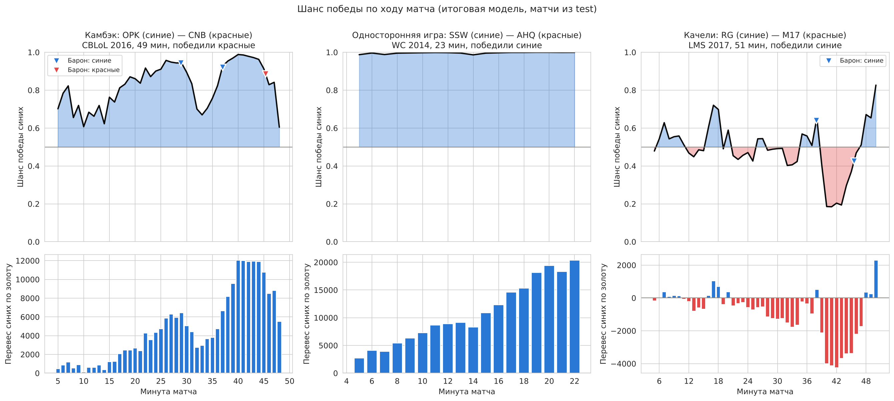

# Вероятность победы в матче League of Legends по ходу игры

Модель, которая на любой минуте матча оценивает шанс победы каждой команды и объясняет, из чего он складывается. Обучена на 7 620 профессиональных матчах 2014–2018 годов.



## Задача

Трансляции киберспорта и аналитические сервисы показывают зрителю шанс победы команд в прямом эфире; тренерским штабам та же оценка нужна для разбора игр. Отсюда требования к модели:

- работать на любой минуте матча;
- выдавать вероятность, которой можно верить (если модель говорит «70%», команда побеждает примерно в 70% таких случаев);
- использовать только то, что уже произошло к этой минуте;
- быть объяснимой.

С точки зрения ML это бинарная классификация: по состоянию матча на минуте `T` предсказать, победит ли синяя команда. Точка отсчёта — правило «победит тот, у кого сейчас больше золота».

## Результаты

Качество итоговой модели (логистическая регрессия) на отложенных 20% матчей:

| Минута матча | 10 | 20 | 30 | все минуты |
|---|---|---|---|---|
| ROC-AUC модели | 0.740 | 0.854 | 0.911 | 0.832 |
| ROC-AUC одного перевеса по золоту | 0.736 | 0.843 | 0.903 | 0.822 |
| Accuracy модели | 67.3% | 76.9% | 82.4% | 74.3% |

Сравнение моделей (все минуты, одна и та же тестовая выборка):

| Модель | CV ROC-AUC (5 фолдов по матчам) | Test ROC-AUC | Log-loss |
|---|---|---|---|
| Baseline: только перевес по золоту | 0.8329 ± 0.0044 | 0.8224 | 0.5081 |
| Decision Tree | 0.8370 ± 0.0031 | 0.8273 | 0.5058 |
| Random Forest | 0.8411 ± 0.0043 | 0.8288 | 0.4987 |
| Gradient Boosting | 0.8417 ± 0.0035 | 0.8307 | 0.4954 |
| MLP (PyTorch) | 0.8421 ± 0.0031 | 0.8314 | 0.4949 |
| **Logistic Regression** | **0.8421 ± 0.0030** | **0.8321** | **0.4934** |
| Stacking | 0.8426 ± 0.0035 | 0.8317 | 0.5031 |
| Blending | — | 0.8317 | 0.4939 |

Главные выводы:

- **Вероятностям можно верить.** Когда на 10–35-й минутах модель уверена на 80% и больше, она права в 88–94% случаев.
- **Почти вся информация о победителе содержится в перевесе по золоту.** Убийства и башни сильны сами по себе, но к золоту ничего не добавляют: команда получает за них золото. Сверх золота работают драконы и темп набора преимущества, и к поздней игре их вес растёт.
- **Сложные модели не лучше простой.** Бустинг, нейросеть и ансамбли на кросс-валидации отличаются от логистической регрессии меньше чем на одно стандартное отклонение, поэтому итоговой выбрана она: её прогноз раскладывается на вклады признаков.
- **Потолок задаёт сама игра.** Команда, ведущая по золоту на 20-й минуте, проигрывает 22% матчей; 87% ошибок модели приходится на моменты, когда перевес меньше 5% золота.
- **Модель устойчива во времени.** Обученная на 2014–2016 годах, она работает на матчах 2017–2018 годов так же, как модель, видевшая эти сезоны.

Подробности — в [отчёте](report.pdf) и в [ноутбуке](lol_win_probability.ipynb).

## Что сделано

1. **Сборка данных.** Исходный файл — списки золота по минутам и события с временем. Из них собрана таблица «матч × минута» (49 994 строки): экономика, убийства и помощь (KDA), башни, драконы, бароны, «кто первый».
2. **Защита от утечки.** В признаки идут только события до минуты прогноза; это проверено отдельным тестом на всех матчах. Train, test и фолды кросс-валидации делятся по матчам, а не по строкам.
3. **EDA и feature engineering.** Распределения, box-plot, корреляции и мультиколлинеарность (VIF), выбросы; относительный перевес по золоту, темп за последние 5 минут, KDA команд.
4. **Модели.** Logistic Regression, Decision Tree, Random Forest, Gradient Boosting (GridSearchCV и RandomizedSearchCV), MLP на PyTorch (выбор архитектуры, Dropout и weight decay, графики обучения), Stacking и Blending.
5. **Стадии матча.** Качество и важность признаков на 10-й, 20-й и 30-й минуте: коэффициенты, permutation importance, SHAP.
6. **Продуктовая часть.** Калибровка вероятностей, график шанса победы по ходу матча, разложение прогноза на вклады признаков.
7. **Дополнительные проверки.** Ablation по группам признаков, ценность золота по ролям, драфт, анализ ошибок и камбэков, проверка на будущих сезонах, демонстрация утечки, кривая обучения.

## Данные

Датасет [League of Legends](https://www.kaggle.com/datasets/chuckephron/leagueoflegends) (Kaggle, лицензия CC0). Данные в репозиторий не входят. Скачайте датасет и положите основной файл в папку `data/`:

```
data/LeagueofLegends.csv
```

## Запуск

```bash
pip install -r requirements.txt
jupyter notebook lol_win_probability.ipynb
```

Полный прогон ноутбука занимает около 10 минут на двух ядрах CPU, GPU не нужен. Графики сохраняются в `figures/`, итоговые таблицы — в `results/`.

Проверено на Python 3.13; точные версии библиотек записаны в `requirements.txt`. Нужен scikit-learn не ниже 1.8: тип регуляризации логистической регрессии задаётся через `l1_ratio`. Случайные зерна зафиксированы, но на другой машине числа у нейросети могут отличаться в третьем-четвёртом знаке.

## Структура

```
lol_win_probability.ipynb   ноутбук: весь код с результатами выполнения
report.pdf                  отчёт: задача, данные, модели, результаты, выводы
requirements.txt            зависимости
figures/                    графики из ноутбука
results/                    итоговые таблицы (csv)
data/                       сюда нужно положить LeagueofLegends.csv
```

## Ограничения

- Данные — профессиональные матчи 2014–2018 годов; для текущей версии игры модель нужно обучить на свежих матчах.
- В данных нет опыта, добитых миньонов, предметов и силы команд (нет дат, поэтому рейтинг по прошлым матчам посчитать нельзя). На ранних минутах модель слаба: на 5-й минуте ROC-AUC 0.66.
- Оценка на тесте (0.832) ниже оценки на кросс-валидации (0.842). Проверка в ноутбуке показывает, что это свойство конкретной тестовой выборки; качество на новых матчах известно с точностью около ±0.007.
